<picture>
  <source media="(prefers-color-scheme: light)" srcset="assets/hero-light.svg">
  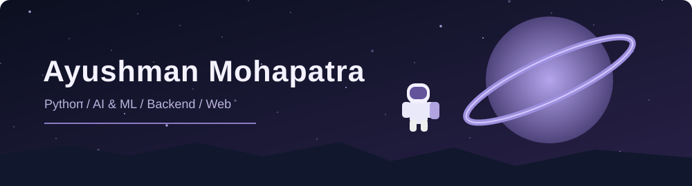
</picture>

  <a href="https://www.linkedin.com/in/ayushman-mohapatra-am015">LinkedIn</a> &nbsp;·&nbsp;
  <a href="https://github.com/AyushmanMohapatra015?tab=repositories">Repositories</a>

## Skills

**Languages & web**

  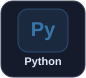
  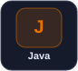
  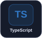
  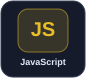
  
  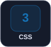

**Frameworks, backend & data**

  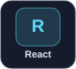
  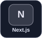
  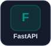
  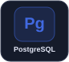
  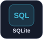
  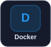

**AI & developer tools**

  
  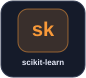
  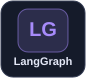
  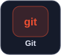
  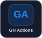
  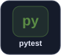
  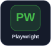

## Selected projects

- **[Dojo](https://github.com/AyushmanMohapatra015/Dojo)** — Coding-agent evaluation and cost analysis.
- **[Nudge](https://github.com/AyushmanMohapatra015/Nudge)** — Freelancer scope management and sandbox invoicing.
- **[Hisaab](https://github.com/AyushmanMohapatra015/Hisaab)** — Hindi voice-based wage ledger.

## Open source

A few merged contributions:

- **Meshery** — [Catalog sorting](https://github.com/meshery/meshery.io/pull/3285) · [Programs page spacing](https://github.com/meshery/meshery.io/pull/3286)
- **Microcks** — [OpenAPI re-import documentation](https://github.com/microcks/microcks.io/pull/78)
- **AOSSIE** — [OpenVerifiableLLM Windows dependencies](https://github.com/AOSSIE-Org/OpenVerifiableLLM/pull/318)

More contributions

[See all authored pull requests](https://github.com/pulls?q=is%3Apr+author%3AAyushmanMohapatra015)

