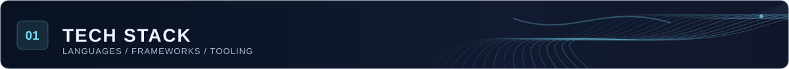
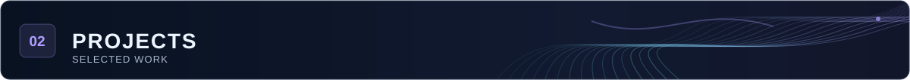
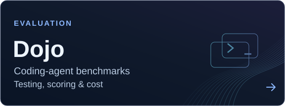
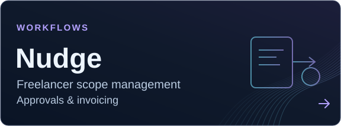
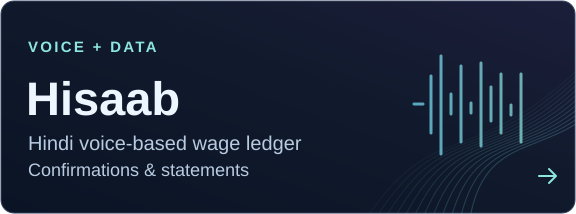
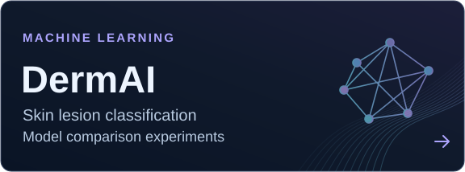
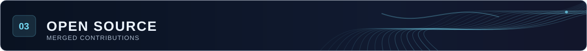

  

  <a href="https://www.linkedin.com/in/ayushman-mohapatra-am015">LinkedIn</a> &nbsp;·&nbsp;
  <a href="https://github.com/AyushmanMohapatra015?tab=repositories">Repositories</a> &nbsp;·&nbsp;
  <a href="https://github.com/search?q=author%3AAyushmanMohapatra015+is%3Apr&type=pullrequests">Pull requests</a>

  

<table width="100%">
  <tr>
    <td width="200" valign="middle"><strong>Languages &amp; web</strong></td>
    <td valign="middle">
      <picture>
        <source media="(prefers-color-scheme: light)" srcset="https://skillicons.dev/icons?i=py,java,ts,js,html,css&amp;theme=light">
        
      </picture>
    </td>
  </tr>
  <tr>
    <td valign="middle"><strong>Frameworks &amp; data</strong></td>
    <td valign="middle">
      <picture>
        <source media="(prefers-color-scheme: light)" srcset="https://skillicons.dev/icons?i=react,nextjs,fastapi,postgres,sqlite&amp;theme=light">
        
      </picture>
    </td>
  </tr>
  <tr>
    <td valign="middle"><strong>ML &amp; tooling</strong></td>
    <td valign="middle">
      <picture>
        <source media="(prefers-color-scheme: light)" srcset="https://skillicons.dev/icons?i=pytorch,sklearn,docker,git,githubactions&amp;theme=light">
        
      </picture>
    </td>
  </tr>
</table>

Also using LangGraph, pytest and Playwright.

  

<table width="100%">
  <tr>
    <td width="50%" valign="top">
      
    </td>
    <td width="50%" valign="top">
      
    </td>
  </tr>
  <tr>
    <td width="50%" valign="top">
      
    </td>
    <td width="50%" valign="top">
      
    </td>
  </tr>
</table>

  

<table width="100%">
  <tr>
    <td width="175"><strong>Meshery</strong></td>
    <td><a href="https://github.com/meshery/meshery.io/pull/3285">Catalog sorting</a> &nbsp;·&nbsp; <a href="https://github.com/meshery/meshery.io/pull/3286">Programs page layout</a></td>
  </tr>
  <tr>
    <td><strong>Microcks</strong></td>
    <td><a href="https://github.com/microcks/microcks.io/pull/78">OpenAPI re-import documentation</a></td>
  </tr>
  <tr>
    <td><strong>AOSSIE</strong></td>
    <td><a href="https://github.com/AOSSIE-Org/OpenVerifiableLLM/pull/318">OpenVerifiableLLM Windows dependencies</a></td>
  </tr>
</table>

All links above point to merged contributions. <a href="https://github.com/search?q=author%3AAyushmanMohapatra015+is%3Apr&type=pullrequests">View all pull requests</a>.
